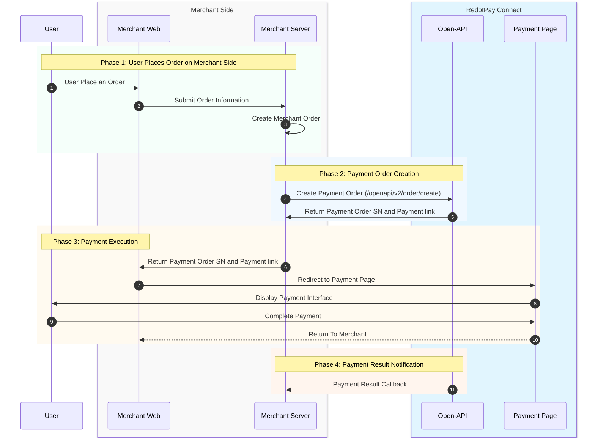
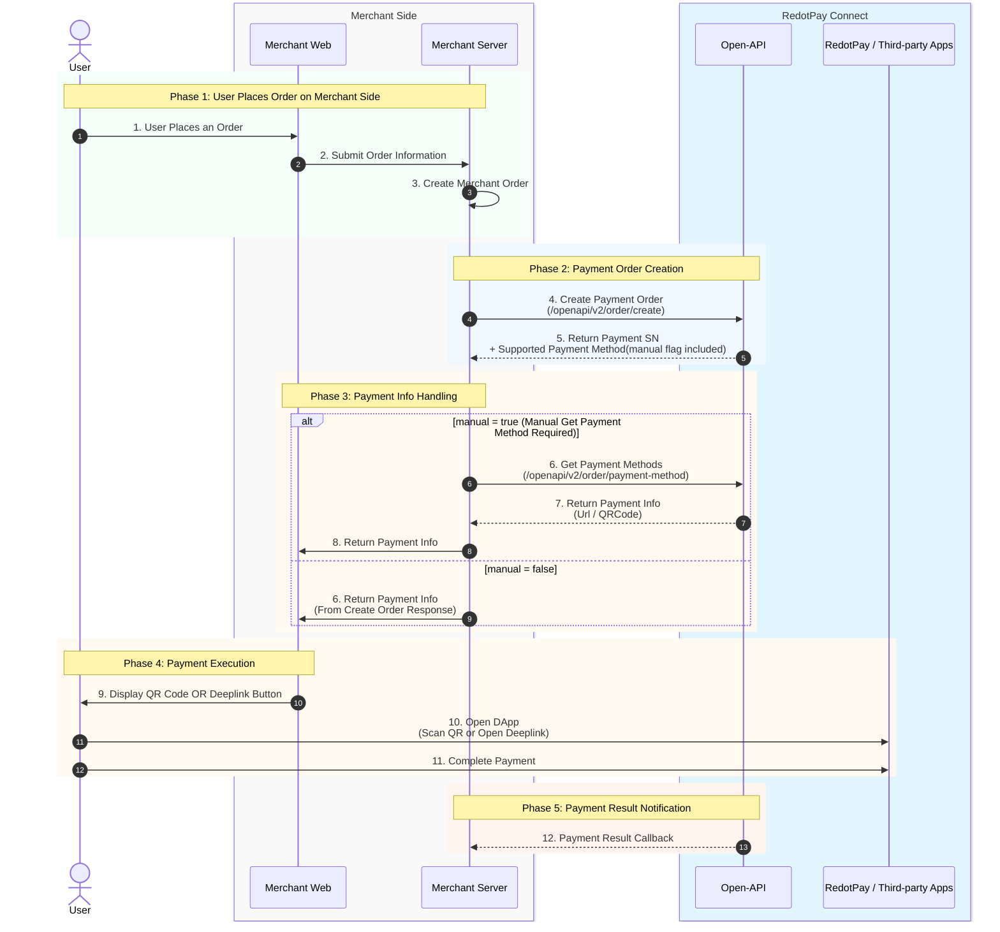

## 📋 Flow Comparison at a Glance

| Feature                  | **Payment via Paylink**                                                                                 | **Payment via Open-API**                                                                                                |
| :----------------------- | :------------------------------------------------------------------------------------------------------ | :---------------------------------------------------------------------------------------------------------------------- |
| **Core Flow**            | Generates a payment link. The user is **redirected** to a RedotPay-hosted page to complete the payment. | Retrieves **payment information (URL/QR Code)** directly via API to complete the payment within the merchant's context. |
| **Primary Use Case**     | Standard H5/Web/App webpage payments.                                                                   | Deeply customized payment interfaces, QR code payments, or DApp redirection.                                            |
| **Merchant Server Role** | Lighter. Mainly creates the order and handles the redirect.                                             | Heavier. Manages fetching payment methods, displaying info, and handling callbacks.                                     |
| **Key Parameter**        | `redirectUrl` (return URL after payment).                                                               | `manual` flag (determines if payment methods must be fetched manually).                                                 |
| **User Journey**         | Leaves the merchant site to pay on the RedotPay page.                                                   | Can stay on the merchant site or pay by scanning a QR code/opening a Deeplink.                                          |

***

## 🔄 Step-by-Step Flow Explanation

### **Flow 1: Payment via Paylink**

This is a standard redirect payment model, ideal for quick integration. The user is guided to a RedotPay-hosted payment page.

**Sequence Diagram: Payment via Paylink**

 

**Participants:**

- **User**
- **Merchant Side**: Web Page, Server
- **RedotPay Connect**: Open-API, Payment Page

**Process Steps:**

1. **User Places Order**: The user selects items and submits an order on the merchant website.
2. **Submit Order Information**: The merchant web page submits the order data to its own server.
3. **Create Merchant Order**: The merchant server creates an internal order record.
4. **Create Payment Order**: The merchant server calls RedotPay's [`/openapi/v2/order/create`](/v2.0/reference/createprepayorder-1) API to request a payment order.
5. **Return Payment Info**: RedotPay API responds with a **Payment Serial Number (SN)** and a `payment link`.
6. **Forward Payment Link**: The merchant server passes the payment link and SN back to the frontend.
7. **Redirect to Payment Page**: The merchant frontend automatically redirects the user's browser to the RedotPay payment link.
8. **Display Payment Interface**: The RedotPay page loads, showing the payment method selection interface.
9. **Complete Payment**: The user selects a payment method and completes the transaction on the RedotPay page.
10. **Return to Merchant**: Upon successful payment, the user's browser is redirected back to the merchant website via the pre-configured `redirectUrl`.
11. **Payment Result Callback**: Simultaneously, RedotPay server sends a final payment result notification to the merchant's configured **Webhook** endpoint. The merchant server must update the order status accordingly.

### **Flow 2: Payment via Open-API**

This flexible integration gives the merchant full control over displaying payment information (e.g., generating its own QR code), suitable for deeply customized flows or embedded payment experiences.

**Sequence Diagram: Payment via Open-API**

 

**Participants:**

- **User**
- **Merchant Side**: Web Page, Server
- **RedotPay / Third-party App**: The application where the payment is finalized (e.g., wallet app).

**Process Steps:**

- **Phases 1-3 (Order Placement & Creation)**: Identical to Steps 1-4 of the "Paylink" flow.
- **Phase 4 (Payment Info Handling - The Decision Point)**: The flow branches here based on the `manual` flag sent in the create order request:
  - **Case A:&#x20;**`manual = false`
    1. The RedotPay API **directly includes** the available payment methods and corresponding payment information (e.g., payment URL or QR code data) in the response to the create order request.
    2. The merchant server forwards this payment information to the frontend.
  - **Case B:&#x20;**`manual = true`
    1. The RedotPay API response **only contains the Payment SN and a list of supported payment methods**.
    2. The merchant server must make an **additional call** to the [`/openapi/v2/order/payment-method`](/v2.0/reference/paymentmethod) API, providing the SN and the user's chosen payment method, to fetch the specific payment instructions.
    3. The RedotPay API returns the corresponding payment information (URL/QR code).
- **Phase 5 (Payment Execution & Notification)**:
  1. **Display Payment Info**: The merchant frontend receives the payment information (URL or QR code data) and displays a **payment QR code** or a **button to trigger a DApp Deeplink** on its own page.
  2. **User Completes Payment**:
     - **QR Code Payment**: The user scans the QR code with the RedotPay or a third-party wallet app to pay.
     - **Deeplink Payment**: The user clicks the button, which opens the wallet app directly via a Deeplink to complete the payment.
  3. **Payment Result Callback**: Regardless of the method, upon payment completion, the RedotPay server sends a Webhook callback to the merchant server with the final result.

## 💡 Key Takeaways & Recommendation

The choice between flows depends on your business needs:

- Choose **Payment via Paylink** for **rapid integration, simpler maintenance**, and if redirecting users to a hosted payment page is acceptable.
- Choose **Payment via Open-API** for a **deeply customized payment experience**, keeping users on your site, or for integrating with DApps. Pay close attention to the logic surrounding the `manual` flag.

For precise technical implementation, always consult:

1. The official API references: [`/openapi/v2/order/create`](/v2.0/reference/createprepayorder-1) and [`/openapi/v2/order/payment-method`](/v2.0/reference/paymentmethod).
2. The [Request Signature and Verification Guide](/v2.0/docs/redotpay-api-request-signature-and-verification-guide) and Webhook documentation mentioned in the source, which are crucial for secure API communication and asynchronous result handling.
